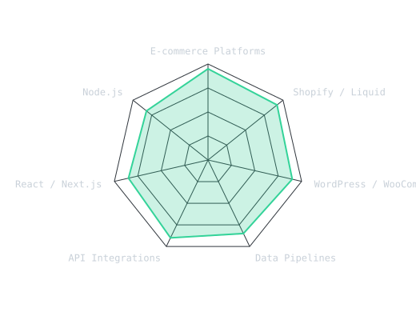
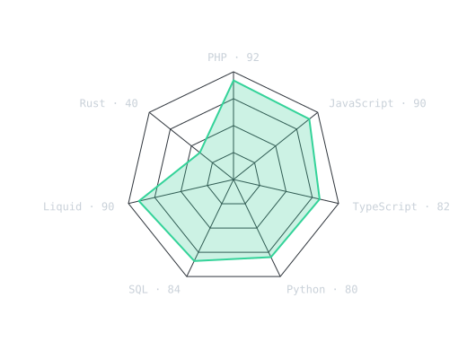
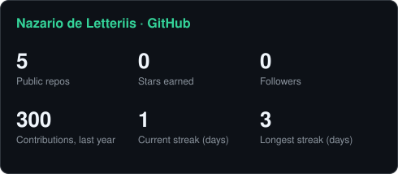

<picture>
  <source media="(prefers-color-scheme: dark)"  srcset="assets/banner-dark.svg">
  <source media="(prefers-color-scheme: light)" srcset="assets/banner-light.svg">
  
</picture>

 

  

&nbsp;&nbsp;
&nbsp;&nbsp;
&nbsp;&nbsp;

---

## About

Lead Full-Stack Developer based in San Mauro Pascoli, Italy, working remotely with teams
across the UK, Italy and the US. I build the unglamorous machinery behind online stores:
data pipelines, API integrations and internal tools, the things that have to be right when
nobody is watching.

- 🛒 **E-commerce at scale**: Shopify Plus, WooCommerce and custom platforms, from theme engineering to catalogues of 35,000 variants.
- 🔌 **Integrations and data**: twelve sources reconciled into numbers a marketing team can trust.
- 🤖 **Applied AI**: vision LLMs in production workflows, always with evidence and human approval.
- 🔒 **Client work**: most of my code is under contract and stays private, so the [portfolio](https://github.com/Nazariodeletteriis/portfolio) documents what each system does and what I built.

## Stack

---

## Signals

<table>
<tr>
<td width="50%" align="center" valign="middle">
<picture>
  <source media="(prefers-color-scheme: dark)"  srcset="assets/radar-dark.svg">
  <source media="(prefers-color-scheme: light)" srcset="assets/radar-light.svg">
  
</picture>
</td>
<td width="50%" align="center" valign="middle">
<picture>
  <source media="(prefers-color-scheme: dark)"  srcset="assets/radar-langs-dark.svg">
  <source media="(prefers-color-scheme: light)" srcset="assets/radar-langs-light.svg">
  
</picture>
</td>
</tr>
</table>

Self-rated, 0 to 100.

---

## Selected work

| Project | What it is | Stack |
|---|---|---|
| [A/B Test Winner Promotion](https://github.com/Nazariodeletteriis/portfolio/blob/main/projects/puursmile-winner.md) | Embedded Shopify app that promotes a winning product page, with preview, backup and rollback | Remix · Polaris · Admin GraphQL |
| [Media Performance Dashboard](https://github.com/Nazariodeletteriis/portfolio/blob/main/projects/puursmile-mp-dashboard.md) | Twelve data sources into one set of numbers a marketing team can trust | Next.js · PostgreSQL · Prisma |
| [B2B Road Signage Store](https://github.com/Nazariodeletteriis/portfolio/blob/main/projects/mondosegnaletica-store.md) | A paper price list turned into 1,200 products and 35,000 variants | PHP · WooCommerce · Python |
| [AI Creative Naming](https://github.com/Nazariodeletteriis/portfolio/blob/main/projects/puursmile-ads.md) | Watches an ad creative and proposes a structured name, with evidence and human approval | Next.js · ffmpeg · vision LLM |

Four more in the [portfolio](https://github.com/Nazariodeletteriis/portfolio): Shopify theme engineering, an offline-first field reporting app, a WordPress booking plugin and a Rust desktop overlay.

## Numbers

<picture>
  <source media="(prefers-color-scheme: dark)"  srcset="assets/card-stats-dark.svg">
  <source media="(prefers-color-scheme: light)" srcset="assets/card-stats-light.svg">
  
</picture>

 

---

**Open to remote Lead / Senior roles, worldwide.**

[nazario@letrionlabs.it](mailto:nazario@letrionlabs.it) · [letrionlabs.it](https://letrionlabs.it) · [LinkedIn](https://www.linkedin.com/in/nazariodeletteriis)

Letrion Lab · Nazario De Letteriis

